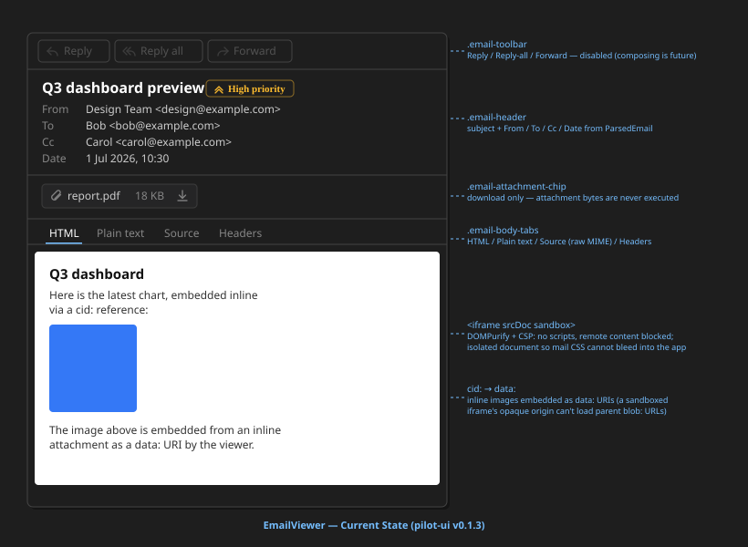

# EmailViewer

Read-only **e-mail viewer**. Renders a normalized `ParsedEmail` — subject,
addresses, importance badge, attachment chips, and a tabbed body
(**HTML / Plain text / Source / Headers**) — inside whatever container hosts it.

The component is **format-agnostic**: it never touches MIME. Parsing is the job
of the mail readers in `src/shared/readers/mail` — `parseEml` for `.eml` and
`parseMsg` for Outlook `.msg` — so the viewer works unchanged for any format that
can produce a `ParsedEmail`. Introduced in issue 075; `.msg` was added in issue
119 **without a single behavioural change here**, which is the split working as
designed.



## What it is good for

- **Previewing `.eml` and `.msg` files** in the Pilot file preview
  (`PreviewHost`) and in the VS Code custom editor (`MailEditorProvider`, view
  types `portunix.eml` and `portunix.msg`)
- **Showing an archived message** anywhere in the app — evidence attached to a
  venture, a mail dropped into a workspace, a message stored with a discussion
- **Inspecting a message safely** — the HTML body is sanitized and rendered in a
  fully sandboxed iframe with a restrictive CSP, so tracking pixels, remote CSS
  and scripts never load. Attachments are download-only and never executed.
- **Debugging mail plumbing** — the Source and Headers tabs expose the raw MIME
  and the full header list without leaving the app. A `.msg` has no MIME source,
  so Source shows its transport headers verbatim when it has them, and otherwise
  a block reconstructed from its MAPI properties, marked as such on its first
  line (issue 119, ADR-4)

It is **not** a mail client: there is no mailbox, no threading, no composing.
The toolbar renders Reply / Reply all / Forward as **disabled placeholders** —
composing was explicitly out of scope for issue 075.

## Usage

```tsx
import { EmailViewer } from '@cassandragargoyle/pilot-ui';
import { parseEml } from '../../shared/readers/mail';

const email = await parseEml(rawEmlText);

<EmailViewer email={email} />;
```

The viewer fills its host container (`height: 100%`, column flex layout), so the
caller only has to give it a sized box.

## Props

| Prop | Type | Description |
| ----- | ----- | ----- |
| `email` | `ParsedEmail` | Normalized message produced by a reader; the only input |
| `dateFormat` | `OsDateTimeFormat?` | How the **operating system** renders dates, resolved by the host: `locale`, plus `shortDate` / `timeFormat` on Windows. Omit when it is unknown — the date then uses the fallback pattern below |

`ParsedEmail` (see `src/shared/readers/mail/model.ts`) carries `subject`,
`from` / `to` / `cc`, `date`, `importance`, optional `html` and `text` bodies,
`attachments` (raw `Uint8Array` bytes), the full `headers` list, the original
`raw` source, and a `format` discriminator (`'eml' | 'msg'`). The viewer never
branches on `format`; it exists so a caller can tell where a message came from.

## Structure

| Part | File | Role |
| ----- | ----- | ----- |
| Toolbar | `EmailToolbar.tsx` | Reply / Reply all / Forward — disabled placeholders |
| Header | `EmailHeader.tsx` | Subject + importance badge, then From / To / Cc / Date rows |
| Attachments | `AttachmentList.tsx` | One chip per attachment, click to download |
| Body | `EmailBody.tsx` | Tabs: HTML, Plain text, Source, Headers |

## Behavior

- **Date follows the OS, not the UI language** — the `Date` row is formatted with
  `formatDateTime` (`src/shared/format`) from the `dateFormat` prop, most faithful
  source first:
  1. the **operating system's own pattern**, when the host reports one. On Windows
     that is `sShortDate` / `sTimeFormat`, so the row reads `01.07.2026 11:00:00`
     exactly like every other application there — the locale's CLDR form would give
     `01. 07. 2026`, which is Czech but not what the machine shows;
  2. the **locale's CLDR form**, when only a BCP 47 tag is known (Linux, macOS);
  3. the **fixed pattern** `2026-09-02 19:44:05` (`YYYY-MM-DD HH:MM:SS`, local time,
     zero-padded, no comma) when nothing is known.

  Seconds appear in every path, which a bare `toLocaleString()` drops. The component
  never reads the format from its environment: inside a webview or an Electron window
  that yields the application UI language, which is the wrong answer (issue 115).
- **Empty rows are omitted** — an address row renders only when it has a value,
  so a message without `Cc` shows no `Cc` line.
- **Importance badge** — `high` and `low` render a labelled chevron badge next
  to the subject; `normal` renders nothing.
- **Attachment strip hides itself** when the message has no attachments.
- **Tabs adapt to content** — `HTML` appears only when the message has an HTML
  part, `Plain text` only when it has a text part; `Source` and `Headers` are
  always available. The first available tab is selected, and the selection
  resets whenever a different message is shown.
- **Attachment download** — clicking a chip creates a transient object URL from
  the attachment bytes, triggers a download with the original filename, and
  revokes the URL immediately. Sizes are shown as `B` / `KB` / `MB`.

## Security

The HTML body is the hostile part of a message, so it is contained on several
independent layers (`inlineHtml.ts` + `EmailBody.tsx`):

1. **Inline images resolved locally** — `cid:` sources are rewritten to `data:`
   URIs built from the matching inline attachments (`data:`, not `blob:`,
   because a fully sandboxed iframe has an opaque origin). Unresolvable `cid:`
   sources have their `src` removed.
2. **Sanitizing** — DOMPurify with `FORBID_TAGS` covering `script`, `iframe`,
   `object`, `embed`, `form`, `base`, `meta`, `link`, plus `FORBID_ATTR: ping`
   and `ALLOW_UNKNOWN_PROTOCOLS: false`.
3. **Sandboxed iframe** — `sandbox=""` (no scripts, no same-origin) with the
   document passed as `srcDoc`, so nothing is fetched from outside.
4. **CSP inside the document** — `default-src 'none'; img-src data:;
   style-src 'unsafe-inline'; font-src data:`, which blocks remote content
   (tracking pixels, external stylesheets) by default.
5. **Attachments are inert** — bytes are only ever offered as a download; there
   is no auto-open path.

## Styling

`EmailViewer.css` holds every rule under the `.email-*` prefix and follows the
[GUI Design Principles](../../../../../docs/architecture/GUI-DESIGN-PRINCIPLES.md):
VS Code theme variables with literal fallbacks, monochrome 16px stroke icons
(`icons.tsx`, `fill: none`, `currentColor`), and a 4px spacing grid. The body
document rendered inside the iframe uses its own light-on-white typography, since
mail HTML assumes a white canvas.

## Integration

- `PreviewHost.tsx` — `MailPreview` renders the viewer for the `mail` preview kind
  and picks the reader by extension: `.eml` comes through the bridge's `readText`,
  `.msg` through its `readBytes`. The OS format comes from the bridge's optional
  `systemDateFormat()`, which the Electron host answers from
  `shared/node/osDateFormat` in main
- `entries/index.eml.vscode.tsx` — webview entry for the VS Code custom editor;
  posts `ready`, receives `setMail`, parses, and renders, with `Loading…` and
  failure states. `setMail` carries `.eml` as `text` and `.msg` as `base64` (the
  transport that survives the webview message boundary unchanged), an `error` when
  the host could not deliver the file at all, and the OS date format resolved in
  the extension host by `shared/node/osDateFormat` (the registry on Windows, POSIX
  `LC_*` / `LANG` elsewhere)
- `src/pilot/ui/index.ts` — public export (`EmailViewer`, `EmailViewerProps`),
  alongside the readers (`parseEml`, `parseMsg`) an external host needs

## Files

- `EmailViewer.tsx` — composition root (toolbar, header, attachments, body)
- `EmailToolbar.tsx` — action toolbar (placeholders)
- `EmailHeader.tsx` — subject, importance badge, address rows
- `AttachmentList.tsx` — attachment chips and download handling
- `EmailBody.tsx` — tabbed body, sandboxed HTML frame
- `inlineHtml.ts` — `cid:` resolution, DOMPurify sanitizing, CSP wrapper
- `icons.tsx` — monochrome 16px stroke icons
- `EmailViewer.css` — all `.email-*` styles
- `EmailViewer.svg` — visual reference (this README's image)
- `index.ts` — public exports (`EmailViewer`, `EmailViewerProps`)

---

**Created**: 2026-08-16
**Last Updated**: 2026-09-07
