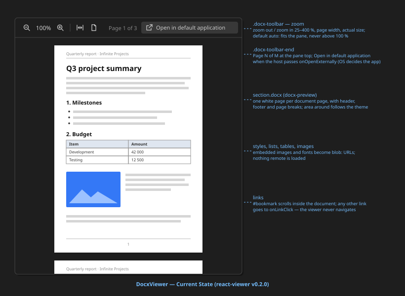

# DocxViewer

Read-only **Word document viewer**. Renders the bytes of a `.docx` file as pages —
text styles, lists, tables, images, headers, footers, footnotes and page breaks —
with a toolbar for zoom and the page position, inside whatever container hosts it.
Introduced in `portunix-vscode`
[issue 136](https://github.com/cassandragargoyle/portunix-vscode/blob/main/docs/issues/136-docx-viewer.md).

The rendering is done by [docx-preview](https://github.com/VolodymyrBaydalka/docxjs);
this component adds the toolbar, the theme, link handling and the loading and failure
states. The host reads the file and passes the bytes; the viewer never touches a path.



## What it is good for

- **Reading a `.docx` without leaving the app** — in `portunix-vscode` the VS Code custom
  editor `portunix.docx` uses it, and the Pilot preview can use it the same way
- **Viewing a document offline and privately** — everything runs locally; nothing is sent
  to an online viewer

It is **not** an editor: there is no editing, no saving, no track-changes view and no
comments.

## Why docx-preview

| Library | License | Result |
| ------- | ------- | ------ |
| **docx-preview** (chosen) | Apache-2.0 | HTML that keeps the page layout: pages, headers, footers, page breaks |
| mammoth | BSD-2-Clause | Semantic HTML without page layout; the document does not look like the original |
| react-doc-viewer | Apache-2.0 | Sends the file to the Microsoft Office online viewer — not offline, not private |
| SuperDoc, ONLYOFFICE | AGPL / commercial | Full editors; license and size rule them out |

`docx-preview` is the only candidate that shows the document as pages, like a PDF viewer,
works offline in a webview and has a license compatible with MIT. The component calls
`parseAsync` and `renderDocument` — the two halves of `renderAsync` — so it can mark the
page number fields in between (see [Limitations](#limitations)). `mammoth` stays the
fallback if real documents render badly.

## Usage

```tsx
import { DocxViewer } from '@cassandragargoyle/react-viewer';

// bytes: the .docx file content as Uint8Array or ArrayBuffer
<DocxViewer data={bytes} onLinkClick={(href) => openInBrowser(href)} />;
```

`docx-preview` is an **optional peer dependency** — install it when you use this viewer:

```bash
npm install docx-preview
```

The viewer fills its host container (`height: 100%`, column flex layout), so the caller
only has to give it a sized box.

## Props

| Prop | Type | Description |
| ---- | ---- | ----------- |
| `data` | `ArrayBuffer \| Uint8Array` | The `.docx` content. A new value (by identity) renders the document again |
| `initialZoom` | `DocxZoom`? | `auto` (default), `fit-width` or a factor (`1` = 100 %) |
| `onLinkClick` | `(href: string) => void`? | A link to outside the document was clicked |
| `onError` | `(error: Error) => void`? | The document could not be rendered |
| `onOpenExternally` | `() => void`? | Shows **Open in default application** in the toolbar; the host opens the file in the application the operating system uses for `.docx` |

## Behavior

- **Zoom** — zoom out / zoom in step through 25 % to 400 %; **Page width** fits the widest
  page to the pane, **Actual size** is 100 %. The default `auto` fits the pane but never
  enlarges above 100 %, the default of a PDF viewer. The fit modes follow the pane size
- **Pages without recorded breaks** — docx-preview breaks pages only where the file
  records a break: a manual break, a section break, or the breaks Word saves when it lays
  the document out. A document produced by a generator has none of these and would show as
  one long page with the footer at its end. After rendering, `paginate.ts` measures each
  page and splits one that is more than 10 % taller than its page size: between blocks,
  and a table between rows. Every new page gets a copy of the header and footer
- **Page numbers** — the results of `PAGE` and `NUMPAGES` fields (`Page 2 of 9` in a
  footer) are marked between parsing and rendering (`fields.ts`) and numbered after the
  split; docx-preview alone shows the value cached in the file on every page
- **Page position** — `Page N of M` shows the page at the top of the pane
- **Open in default application** — shown only when the host passes `onOpenExternally`.
  The viewer does not know the file or the operating system; the host decides (on Windows
  usually Microsoft Word). The action stays enabled when the document fails to render,
  because another application may still open it
- **Links never navigate the viewer** — a bookmark (`#name`) scrolls to its target in the
  document; any other link is passed to `onLinkClick` and the host decides whether to open
  it. Without the prop, such a click does nothing
- **Failure** — a file that is not a valid `.docx` shows
  `This document cannot be displayed: <reason>` in the pane and calls `onError`
- **Re-render without flicker** — a new `data` value renders off-screen and replaces the
  old pages when done; the old document stays visible meanwhile

## Limitations

The page split is an approximation of Word's layout, not a copy of it:

- A split falls between paragraphs and table rows; a paragraph is never split across
  pages, and the header row of a split table is not repeated
- A block taller than a page (a large image) stays on one page and overflows it
- Column sections and pages with several sections are left as docx-preview renders them
- The copied header and footer are the ones of the first page of the section; a different
  first-page or even-page header is not chosen again for the added pages
- `parseAsync` and `renderDocument` are documented by docx-preview as experimental. If
  their element tree changes, the page numbers stay at the cached value; the split itself
  works on the rendered HTML and does not depend on it

## Security

- No network access of its own; images and fonts embedded in the document become `blob:`
  URLs. A host should still set a Content Security Policy that allows only `blob:` and
  `data:` images and fonts, so a document cannot load anything remote
- Links are never followed by the viewer; the host filters them (the VS Code host opens
  `http`, `https` and `mailto` only)

## Styling

`DocxViewer.css` holds every rule under the `.docx-viewer` / `.docx-toolbar` prefix and
follows the
[GUI Design Principles](https://github.com/cassandragargoyle/portunix-vscode/blob/main/docs/architecture/GUI-DESIGN-PRINCIPLES.md):
VS Code theme variables with literal fallbacks, monochrome 16px stroke icons (`icons.tsx`),
and a 4px spacing grid. The pages stay white like paper; the area around them follows the
theme. docx-preview writes its own document styles next to the pages.

## Files

- `DocxViewer.tsx` — rendering, zoom state, page tracking, link handling
- `DocxToolbar.tsx` — zoom and page controls, "open in default application" (stateless)
- `layout.ts` — zoom steps, fit modes, current page lookup (pure)
- `paginate.ts` — splits pages that are taller than their page size, numbers the pages
- `fields.ts` — marks the PAGE / NUMPAGES field results in the parsed document
- `icons.tsx` — monochrome 16px stroke icons
- `DocxViewer.css` — all `.docx-viewer` / `.docx-toolbar` styles and the docx-preview overrides
- `DocxViewer.svg` — visual reference (this README's image)
- `index.ts` — public exports (`DocxViewer`, `DocxViewerProps`, `DocxZoom`)
- `DocxViewer.test.tsx`, `layout.test.ts`, `paginate.test.ts`, `fields.test.ts` — component
  (docx-preview mocked), helpers, the page split (heights faked, jsdom has no layout) and
  the field marking

---

**Created**: 2026-10-21
**Last Updated**: 2026-10-21
